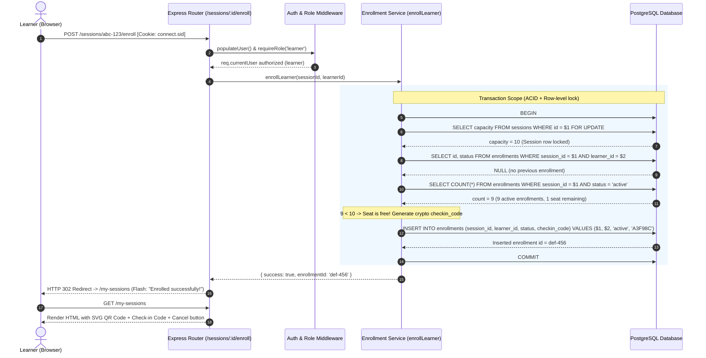

# Workshop House – Technical Architecture & Design Note
*Advanced Web Programming (SFWE475) – Course Project*

---

## 1. System Architecture (3-Tier Model)

Workshop House follows a strict three-tier architecture with server-side validation and transactional data integrity:

```
+-----------------------------------------------------------------------+
|                              TIER 1: BROWSER                          |
|  - Server-rendered HTML (Nunjucks) with WCAG 2.2 AA landmarks         |
|  - Pure CSS theme with CSS variables (light, high contrast, scaling)  |
|  - Minimal browser JS (shortcuts.js with modifiers, inline SVG QR)    |
+-----------------------------------------------------------------------+
                                   |
                             HTTPS / Cookies
                        (httpOnly, sameSite: lax)
                                   v
+-----------------------------------------------------------------------+
|                            TIER 2: EXPRESS APP                        |
|  - Runtime: Node.js 20+ with Express 5 (ESM, TypeScript strict)       |
|  - Validation: Server-side Zod schemas (one schema per request)       |
|  - Auth & Security: Cookie session store (connect-pg-simple)          |
|  - Thin Routes -> Services: Business rules isolated in src/services/  |
|  - Explicit Row Locking: FOR UPDATE transactions for seat management  |
+-----------------------------------------------------------------------+
                                   |
                        Plain Parameterized SQL
                           (node-postgres: pg)
                                   v
+-----------------------------------------------------------------------+
|                          TIER 3: POSTGRESQL                           |
|  - Relational tables with strict CHECK and FOREIGN KEY constraints    |
|  - Row-level concurrency control with ACID isolation                  |
|  - Cryptographic randomness (pgcrypto / crypto.randomBytes)           |
+-----------------------------------------------------------------------+
```

---

## 2. Database Schema & Integrity Constraints

All tables are managed via plain SQL migrations ([`001_initial_schema.sql`](file:///c:/Users/hniyi/Desktop/Workshop-project/src/db/migrations/001_initial_schema.sql)). No ORM is used.

### Core Tables & Business Constraints:
1. **`users`**:
   - `id UUID PRIMARY KEY DEFAULT gen_random_uuid()`
   - `name TEXT NOT NULL`, `email TEXT UNIQUE NOT NULL`, `password_hash TEXT NOT NULL` (Argon2)
   - `role TEXT NOT NULL CHECK (role IN ('learner', 'trainer', 'coordinator'))`
2. **`courses`**:
   - `id UUID PRIMARY KEY DEFAULT gen_random_uuid()`, `title TEXT NOT NULL`, `description TEXT NOT NULL`
3. **`sessions`**:
   - `id UUID PRIMARY KEY DEFAULT gen_random_uuid()`
   - `course_id UUID REFERENCES courses(id) ON DELETE CASCADE`
   - `trainer_id UUID REFERENCES users(id) ON DELETE RESTRICT`
   - `starts_at TIMESTAMPTZ NOT NULL`, `ends_at TIMESTAMPTZ NOT NULL`
   - `room TEXT NOT NULL`, `capacity INTEGER NOT NULL CHECK (capacity > 0)`
   - `resource_url TEXT`
   - `CONSTRAINT chk_ends_after_starts CHECK (ends_at > starts_at)`
4. **`enrollments`**:
   - `id UUID PRIMARY KEY DEFAULT gen_random_uuid()`
   - `session_id UUID REFERENCES sessions(id) ON DELETE CASCADE`
   - `learner_id UUID REFERENCES users(id) ON DELETE CASCADE`
   - `status TEXT NOT NULL CHECK (status IN ('active', 'cancelled'))`
   - `enrolled_at TIMESTAMPTZ NOT NULL DEFAULT NOW()`, `cancelled_at TIMESTAMPTZ`
   - `checkin_code TEXT UNIQUE NOT NULL` (cryptographically random hex)
   - `CONSTRAINT uq_session_learner UNIQUE (session_id, learner_id)`
5. **`attendance`**:
   - `id UUID PRIMARY KEY DEFAULT gen_random_uuid()`
   - `enrollment_id UUID NOT NULL UNIQUE REFERENCES enrollments(id) ON DELETE CASCADE`
   - `status TEXT NOT NULL CHECK (status IN ('attended', 'absent'))`
   - `method TEXT NOT NULL CHECK (method IN ('manual', 'code'))`
   - `marked_by UUID NOT NULL REFERENCES users(id)`
6. **`completions`**:
   - `id UUID PRIMARY KEY DEFAULT gen_random_uuid()`
   - `enrollment_id UUID NOT NULL UNIQUE REFERENCES enrollments(id) ON DELETE CASCADE`
   - `recorded_by UUID NOT NULL REFERENCES users(id)`, `completed_at TIMESTAMPTZ NOT NULL`
7. **`announcements`**:
   - `id UUID PRIMARY KEY DEFAULT gen_random_uuid()`, `session_id UUID REFERENCES sessions(id) ON DELETE CASCADE`
   - `author_id UUID REFERENCES users(id)`, `body TEXT NOT NULL`
8. **`user_preferences`**:
   - `user_id UUID PRIMARY KEY REFERENCES users(id) ON DELETE CASCADE`
   - `text_scale TEXT NOT NULL DEFAULT '100'`, `high_contrast BOOLEAN NOT NULL DEFAULT FALSE`
   - `reduced_motion BOOLEAN NOT NULL DEFAULT FALSE`, `shortcuts_enabled BOOLEAN NOT NULL DEFAULT TRUE`
9. **`session`**:
   - Session store managed by `connect-pg-simple` with automated expiration cleanup.

### Critical Integrity Decisions:
- **Remaining Seats Calculation**: Remaining seats are **never stored** as a column in the database; they are calculated dynamically via parameterized SQL queries (`s.capacity - COUNT(active enrollments)`) to eliminate race conditions and desynchronization.
- **Attendance & Completion Isolation**: Attendance and completion are separate tables; an enrollment row is never overwritten or mutated to represent attendance or completion.
- **Capacity Floor**: Capacity cannot be lowered below the current count of active enrollments in a session.

---

## 3. End-to-End Request Path: Learner Workshop Enrollment (BR-01 / NFR-03)

This section traces a complete path through the architecture from the user's browser interaction to database row locking and back.



### Path Step Explanation:
1. **Browser**: The learner clicks "Enroll in this Session" on [`/sessions/:id`](file:///c:/Users/hniyi/Desktop/Workshop-project/src/views/pages/sessions/detail.njk). An HTTP POST request is dispatched with the session cookie.
2. **Express Middleware**: `populateUser` resolves the session from PostgreSQL and attaches `req.currentUser`. `requireRole('learner')` verifies authorization. If unauthenticated, it redirects to `/auth/login`; if unauthorized (e.g. trainer), it returns `403 Forbidden`.
3. **Enrollment Service (`src/services/enrollment.ts`)**:
   - Executes `BEGIN`.
   - Acquires an exclusive row-level lock on the session with `SELECT capacity FROM sessions WHERE id = $1 FOR UPDATE`. Any competing request waits on this lock.
   - Verifies existing enrollment status: if already active, rolls back and returns `ALREADY_ENROLLED`.
   - Counts active enrollments: if `active_count >= capacity`, rolls back and returns `FULL` (`"X of X seats taken"`).
   - If the user was previously cancelled, reactivates the existing row (`UPDATE enrollments SET status='active', cancelled_at=NULL`).
   - If a new enrollment, inserts the new row with a cryptographically secure random check-in code.
   - Executes `COMMIT`.
4. **Response**: Sets flash message in session and redirects to `/my-sessions`. The page renders the user's active session, unique check-in code, and generated QR code SVG.

---

## 4. Accessibility (WCAG 2.2 AA) Architecture

Accessibility is engineered directly into the foundational layer:
- **Landmarks & Semantics**: Every page features `<header role="banner">`, `<nav aria-label="...">`, `<main id="main-content">`, and `<footer role="contentinfo">`.
- **Skip Navigation**: Accessible skip link (`.skip-link`) allows keyboard users to bypass header navigation and jump directly to `#main-content`.
- **Keyboard Shortcuts (WCAG 2.1.4)**: Modifiers (`Alt + Shift + [S/M/D/A/K/H]`) prevent accidental single-key activation. Shortcuts can be globally toggled on or off in User Preferences.
- **Form Error Summary**: Form submission failures focus on an error summary banner (`role="alert"`, `tabindex="-1"`) with links to invalid fields associated via `aria-describedby` and `aria-invalid="true"`.
- **Visual Contrast & Zoom**: Minimum 4.5:1 contrast across all themes; touch targets meet or exceed 44x44 px; layout reflows seamlessly up to 200% zoom.
